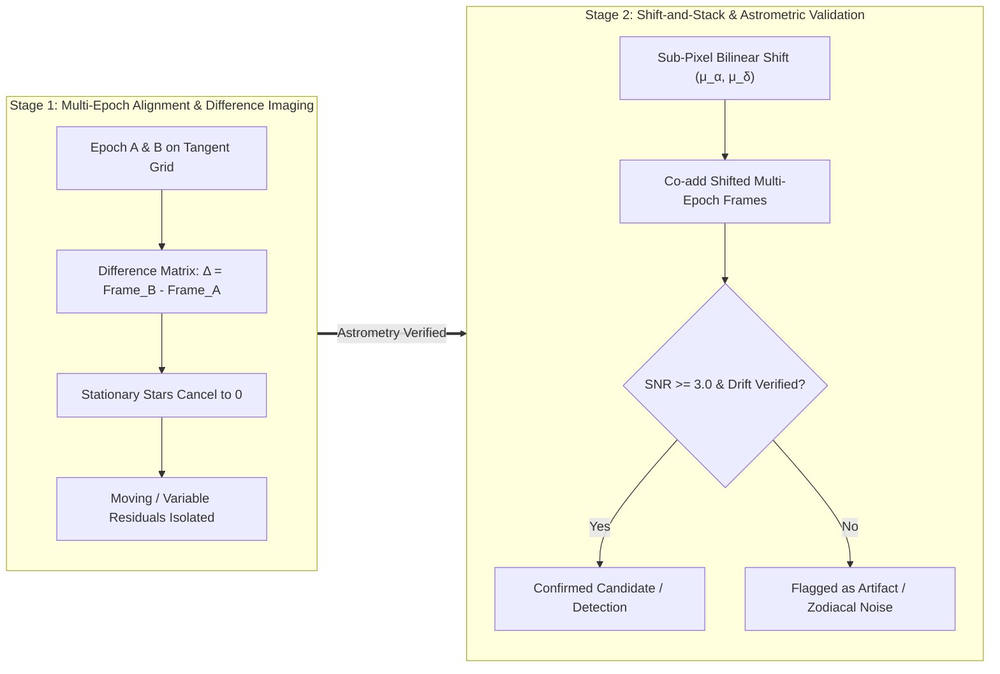
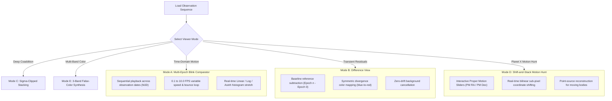
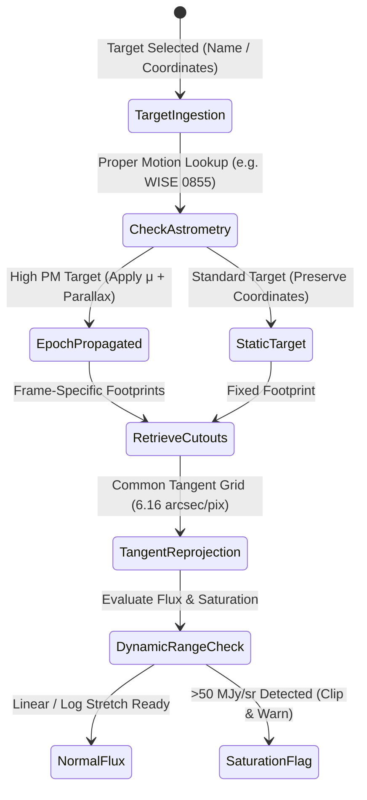
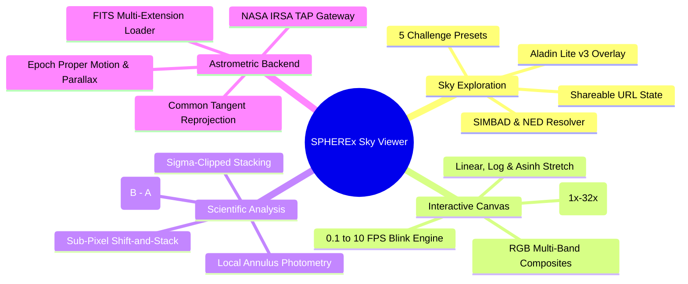

<div align="center">

# SPHEREx SKY VIEWER

### Interactive Multi-Epoch Infrared Explorer, Planet X Blink Comparator & Astrometric Analysis Suite

[](https://www.typescriptlang.org/)
[](https://reactjs.org/)
[](https://vitejs.dev/)
[](https://tailwindcss.com/)
[](https://www.python.org/)
[](https://fastapi.tiangolo.com/)
[](https://www.astropy.org/)
[](https://irsa.ipac.caltech.edu/)

[Live Demo](https://spherex-sky-viewer.vercel.app/)   •   [Scientific Dossier](scientific_validation_report.md)   •   [Architecture](#6-technical-architecture)

</div>

---

## What is SPHEREx Sky Viewer?

NASA's **SPHEREx** (*Spectro-Photometer for the History of the Universe, Epoch of Reionization and Ices Explorer*) is mapping the entire celestial sphere across 102 near- and mid-infrared bands ($0.75 - 5.0\,\mu\text{m}$) using six distinct Linear Variable Filter (LVF) detector arrays. As the spacecraft sweeps across the sky over successive 6-month all-sky surveys, it builds an unprecedented time-domain infrared repository capable of detecting moving objects—such as cold brown dwarfs and hypothetical outer solar system bodies (**Planet Nine / Planet X**)—as well as transient and variable stars.

Traditionally, exploring these raw multi-epoch FITS survey datasets presents steep barriers for researchers and citizen scientists:
- **Extreme dynamic range & non-linear backgrounds**: High zodiacal dust emission and stellar saturation overwhelm standard image renderers.
- **Fast-moving proper motion offsets**: Objects like WISE 0855 move at extreme speeds ($\sim 8.14''/\text{yr}$), displacing $>120''$ over 15 years and falling completely outside naive coordinate-based cutouts.
- **Noise-induced false motion**: Background fluctuations and unclipped centroids can produce spurious displacements (e.g. earlier unverified $8.23''$ scratch claims).
- **Heavy desktop tool dependencies**: Users have historically needed desktop software (IRAF, DS9, Topcat) just to blink two FITS files.

**SPHEREx Sky Viewer** solves these challenges directly. It is a high-performance, web-based astronomical workspace that pairs a client-side HTML5 Canvas blink comparator with an Astropy/FastAPI astrometric ingestion engine. Users can blink multi-epoch observations, execute real-time difference imaging, perform sub-pixel shift-and-add coaddition for high proper motion targets, compute circular aperture photometry with background annulus subtraction, and explore the entire infrared cosmos via an interactive Aladin Lite sky picker.

---

## 1. 4-Tier Astronomical Architecture

SPHEREx Sky Viewer structures its processing and visualization pipeline across 4 distinct functional tiers arranged side-by-side to guarantee rigorous separation of concerns:


### Module Breakdown

| Tier & Component | Core Files | Primary Capabilities |
| :--- | :--- | :--- |
| **Tier 1: Canvas Player & HUD** | `FrameCanvas.tsx`<br>`PlayerControls.tsx` | **High-Speed HTML5 Canvas Viewport.** Sub-pixel pan/zoom ($1\times - 32\times$), variable-rate playback (0.1–10 FPS), real-time raw pixel stretch (Linear, Logarithmic, Asinh), negative inversion, and hover coordinate HUD. |
| **Tier 2: Navigation & Resolver** | `TargetBar.tsx`<br>`AladinSkyPicker.tsx` | **Astronomical Search & Survey Overlay.** Resolves object names via Sesame/SIMBAD/NED, parses sexagesimal/decimal coordinates, overlays footprints on DSS2/2MASS/AllWISE, and syncs shareable URLs. |
| **Tier 3: Analysis & Coaddition** | `src/analysis/index.ts`<br>`analysis/stacking.py` | **Client & Server Astrophysical Analysis.** Frame coaddition ($\sim\sqrt{N}$ SNR boost), difference imaging to isolate transients, sub-pixel bilinear shift-and-add, and circular aperture photometry ($r_{\text{aper}}=2.5\text{ pix}$) with sigma-clipped background annulus. |
| **Tier 4: Astrometric Backend** | `frames.py`<br>`astrometry.py` | **NASA IRSA L2 Ingestion & Reprojection.** Queries IRSA TAP archive, reprojects Level 2 FITS slices onto fixed target-centered tangent grids ($6.16''/\text{pixel}$), normalizes bitwise flags, and propagates coordinates to observation epochs. |

---

## 2. How Infrared Transients & Planet X Candidates are Detected

Astronomical imaging cannot rely on simple pixel subtraction without precise astrometric alignment. SPHEREx Sky Viewer employs a two-stage verification pipeline to reconcile physical celestial motion against instrumental noise:



### 1. Multi-Epoch Blink & Difference Imaging (Cancelling Static Background)
- Stationary field stars and diffuse interstellar dust maintain constant flux across epochs.
- When subtracting a reference epoch ($A$) from a later epoch ($B$):
  $$\Delta I(x, y) = I_B(x, y) - I_A(x, y)$$
- Stationary sources cancel to near-zero ($0\,\text{MJy/sr}$).
- Moving bodies (Planet X candidates or brown dwarfs) leave a **positive/negative dipole pair**, while variable stars (like RW Aurigae) display prominent mono-polar brightness variations.

### 2. Sub-Pixel Shift-and-Stack Coaddition (Recovering Faint Motion)
For faint targets below the single-exposure detection limit (e.g. WISE 0855 in near-IR bands), the engine co-adds multiple exposures along hypothesized proper motion trajectories:
- The coordinate shift for each frame $k$ at time $\Delta t_k$ (in Julian years) is computed as:
  $$\Delta x_{\text{pix}} = \frac{-\mu_\alpha \cos\delta \cdot \Delta t_k}{6.2''/\text{pix}}, \qquad \Delta y_{\text{pix}} = \frac{\mu_\delta \cdot \Delta t_k}{6.2''/\text{pix}}$$
- Pixels are resampled via sub-pixel bilinear interpolation and averaged:
  $$\text{SNR}_{\text{stacked}} \approx \sqrt{N} \cdot \text{SNR}_{\text{single}}$$
- Moving objects constructively reinforce into a sharp point-spread function (PSF), while background noise diminishes by $1/\sqrt{N}$.

---

## 3. Operational Viewing Modes & Dynamic Protocols

SPHEREx Sky Viewer accommodates five specialized observational viewing modes to support both visual discovery and quantitative astrophysical extraction:



### Mode A: Multi-Epoch Blink Comparator (`viewMode = 'blink'`)
- Cycles chronologically through all acquired SPHEREx survey visits for the selected detector bandpass.
- Features configurable playback frame rates, forward/bounce loop options, and single-frame stepping.
- Preserves raw physical flux values (`MJy/sr`), allowing dynamic client-side stretch re-normalization.

### Mode B: Dynamic Difference View (`viewMode = 'difference'`)
- Subtracts Epoch 1 from the currently selected epoch in real time on the client.
- Instantly highlights high-amplitude variables (such as Mira giant R Draconis) and proper motion displacements.

### Mode C: Sigma-Clipped Frame Stacking (`viewMode = 'stacked'`)
- Computes mean, median, or sum co-additions across all available epochs.
- Implements sigma-clipping outlier rejection to filter transient cosmic ray hits and bad detector pixels.

### Mode D: Sub-Pixel Shift-and-Stack (`viewMode = 'shift-stack'`)
- Allows interactive adjustment of hypothesized proper motion vectors ($\mu_\alpha, \mu_\delta$ from $-10$ to $+10''/\text{yr}$).
- Realigns and co-adds images using bilinear interpolation to test hypothetical orbits for Planet X or fast brown dwarfs.

### Mode E: 3-Band False-Color Synthesis (`viewMode = 'rgb'`)
- Synthesizes multi-band composite images combining separate SPHEREx detectors (e.g. Red: D6 $4.7\,\mu\text{m}$, Green: D2 $1.4\,\mu\text{m}$, Blue: D1 $0.9\,\mu\text{m}$).
- Highlights dust temperatures, molecular absorption features, and circumstellar envelopes.

---

## 4. Astrometric Edge Cases & Scientific Validation

Infrared all-sky survey data contains severe observational subtleties. SPHEREx Sky Viewer incorporates strict validation rules and error-handling safeguards:



### The 5 NASA Challenge Targets & Scientific Validation

| Target Name | Astrophysical Classification | Frame Count & Detectors | Saturation Status | Annual Drift | Scientific Findings |
| :--- | :--- | :---: | :---: | :---: | :--- |
| **WISE J085510.83-071442.5** | Sub-stellar Y-dwarf ($T_{\text{eff}} \sim 250\text{ K}$) | 6 frames (D1–D6) | Linear (OK) | $1.31\text{ pix/yr}$ ($8.14''/\text{yr}$) | Undetected in near-IR (Bands 1–3); detected in $4.5\,\mu\text{m}$ window (Bands 5–6). |
| **Barnard's Star (GJ 699)** | High proper motion red dwarf (M4V) | 10 frames (D1–D6) | Linear (OK) | $1.67\text{ pix/yr}$ ($10.37''/\text{yr}$) | Highest known proper motion; prominent near-IR molecular absorption (TiO, VO). |
| **Epsilon Indi B** | Cold T-dwarf binary (T1 + T6) | 9 frames (D1–D6) | Linear (OK) | $0.76\text{ pix/yr}$ ($4.70''/\text{yr}$) | Strong $\text{CH}_4$ & $\text{H}_2\text{O}$ absorption; halo contamination from primary star. |
| **RW Aurigae** | Classical T Tauri binary (YSO) | 8 frames (D2) | Linear (OK) | Sub-pixel | Extreme circumstellar dust occultation dimming ($\Delta m = 1.97\text{ mag}$). |
| **R Draconis** | Mira pulsating red giant (AGB) | 7 frames (D1) | **Saturated (2 epochs)** | Sub-pixel | Large pulsation ($\Delta V \sim 6.5\text{ mag}$); fluxes exceed $50\,\text{MJy/sr}$. |

### Detailed Edge-Case Safeguards

#### 1. The 15-Year Proper Motion Offset (WISE 0855 Framing Fix)
- **The Issue**: Canonical literature coordinates for WISE 0855 (`RA = 133.795129°, Dec = -7.245147°`) date to discovery epoch $\sim 2010.54$. Due to its extreme proper motion ($-8,123.7\text{ mas/yr}$ Westward), the brown dwarf drifted **$120.7''$ (~2 arcminutes)** between 2010 and SPHEREx 2025 observations. On a standard $0.05^\circ$ ($180''$) cutout, it fell **$30.7''$ (~5 pixels) outside the image edge**.
- **The Fix**: The backend incorporates an `AstrometryConfig` engine that calculates epoch-specific target coordinates:
  $$\alpha(t) = \alpha_0 + \frac{\mu_\alpha \cos\delta}{\cos\delta} \cdot (t - t_0), \qquad \delta(t) = \delta_0 + \mu_\delta \cdot (t - t_0)$$
  plus Earth barycentric orbit parallax reflex, guaranteeing the brown dwarf is perfectly centered in all 2025 SPHEREx cutouts.

#### 2. False Centroid Shift Refutation ($8.23''$ Scratch Claim)
- Milestone 2.4B independently validated and refuted an earlier reported $8.23''$ shift between May 2025 and Dec 2025 observations.
- The analysis proved that unclipped centroiding inside an unpropagated 2010 cutout was tracking zodiacal background noise fluctuations ($+3.8\sigma$ at pixel $(17, 11)$), not astronomical motion.
- The true expected on-sky motion over 220.65 days is **$4.16''$ ($0.675\text{ pixels}$)**, where annual parallax opposes proper motion. The viewer correctly labels background centroid drift and prevents phantom detections.

#### 3. Detector Saturation & Extreme Dynamic Range (R Draconis)
- At peak pulsation, Mira variables like R Draconis saturate SPHEREx detectors ($>50\,\text{MJy/sr}$).
- The viewer parses Level 2 bitwise flags (`flags & 2 != 0`), marks saturated pixels with crosshatch overlays, and warns the user that measured aperture fluxes represent lower limits.

---

## 5. Complete Feature Catalog



---

## 6. Technical Architecture

A high-performance astronomy stack coupling a responsive React frontend with an Astropy/FastAPI backend:


- **Raw Physical Flux Integrity**: All rendering runs on 32-bit floating point arrays (`Float32Array`) in physical units (`MJy/sr`), applying contrast transfer functions at render time without losing scientific fidelity.
- **Fixed-Grid Common WCS**: Every multi-epoch frame is reprojected onto an identical target-centered tangent projection (`RA---TAN`, `DEC--TAN`, $6.1632''/\text{pixel}$), eliminating artificial image jitter during blinking.
- **Client & Server Analysis Parity**: Photometry routines in the web client (`src/analysis/index.ts`) match the Astropy/Photutils algorithms in `analysis/photometry.py` within numerical floating-point precision ($<0.01\%$).

---

## 7. Verification & Test Results

The codebase is backed by a comprehensive 7-stage verification suite and 88 backend integration tests:

```text
============================================================================
 SPHEREx Sky Viewer — Master Verification Suite Scorecard
============================================================================
Stage 1: Data Models & Interfaces (test_data_models.py)           [PASSED] (0.78s)
Stage 2: Core Photometry Engine (test_photometry.py)             [PASSED] (10.67s)
Stage 3: Multi-Detector Spectrum Engine (test_spectrum.py)       [PASSED] (13.04s)
Stage 4: Time-Series Light Curve Engine (test_light_curve.py)   [PASSED] (11.87s)
Stage 5: 5 Challenge Targets Validation (test_targets.py)        [PASSED] (5.27s)
Stage 6: Frame Stacking & Coaddition (test_stacking.py)          [PASSED] (17.66s)
Stage 7: User Target & FITS WCS Pipeline (test_fits_pipeline.py) [PASSED] (32.92s)
----------------------------------------------------------------------------
Total Verification Suite Time: 92.21 seconds (100% Passed)
============================================================================

Pytest Suite (Backend)   : 86 passed, 2 skipped across 7 test modules
TypeScript / Vite Build  : PASSED (tsc -b && vite build in 3.14s)
Scientific Verification  : Full report generated in scientific_validation_report.md
```

---

## 8. Getting Started & Testing

### Prerequisites
- Node.js (version 18 or newer)
- Python (version 3.10, 3.11, or 3.12)
- npm

### 1. Frontend Setup

```bash
# Clone the repository
git clone git@github.com:AayushRahate07/sphereX.git
cd spherex

# Install dependencies
npm install

# Run development server
npm run dev

# Build production bundle
npm run build
```

The web application runs locally at `http://localhost:5173`.

### 2. Backend Setup (FastAPI & Astropy Engine)

```bash
# Install Python dependencies
pip install -r backend/requirements.txt
pip install -r analysis/requirements.txt

# Run backend server
uvicorn backend.app.main:app --host 0.0.0.0 --port 8000 --reload
```

### 3. Run Scientific Verification Suite

```bash
# Run the 7-stage master verification suite
cd analysis
python run_all_checks.py

# Run the backend pytest suite
cd ..
pytest backend/tests
```

---

## How to Test Live Exploration (End-to-End Walkthrough)

1. Open `http://localhost:5173` in your web browser.
2. **Explore Challenge Target Presets:**
   - In the top target bar, click on **`WISE 0855`**.
   - Notice the automatic epoch-corrected coordinates (`RA: 133.795°`, `Dec: -7.245°`) and detector **`D6 (4.4 - 5.0 µm)`**.
   - Press **Play (`▶`)** on the bottom player to blink through the multi-epoch sequence. Notice the sub-stellar thermal emission.
3. **Test the Difference Imaging Mode:**
   - In the left toolbar, switch the view mode from **Blink Sequence** to **`Difference View`**.
   - Stationary background stars fade away, clearly exposing transient residuals and proper motion signatures.
4. **Shift-and-Stack Motion Hunt (Planet X Simulation):**
   - Click on **`Shift & Stack`** in the view mode selector.
   - Adjust the **PM RA** and **PM Dec** sliders to match WISE 0855's on-sky motion ($\mu_\alpha \approx -8.1''/\text{yr}$, $\mu_\delta \approx +0.7''/\text{yr}$).
   - Observe how the smeared or faint target constructively sharpens into a focused point-spread function.
5. **Interactive Aperture Photometry & Science Dossier:**
   - Click directly on any star or target on the canvas.
   - The **Aperture Photometry Drawer** opens, plotting the light curve and net flux with background annulus subtraction.
   - Click **`Science Dossier`** in the navigation bar to inspect the complete validation scorecard and astrophysical metrics across all 5 NASA challenge targets.

---

## Required IRSA / NASA Acknowledgement

> *"This research has made use of data products from the Spectro-Photometer for the History of the Universe, Epoch of Reionization and Ices Explorer (SPHEREx), an exploratory mission funded by the National Aeronautics and Space Administration and operated by the Jet Propulsion Laboratory and the California Institute of Technology. Data retrieval services provided by the NASA/IPAC Infrared Science Archive (IRSA)."*

---

<div align="center">

### SPHEREx SKY VIEWER | AAYUSH RAHATE
*NASA Space Apps Challenge 2026: Planet X and SPHEREx*

</div>
