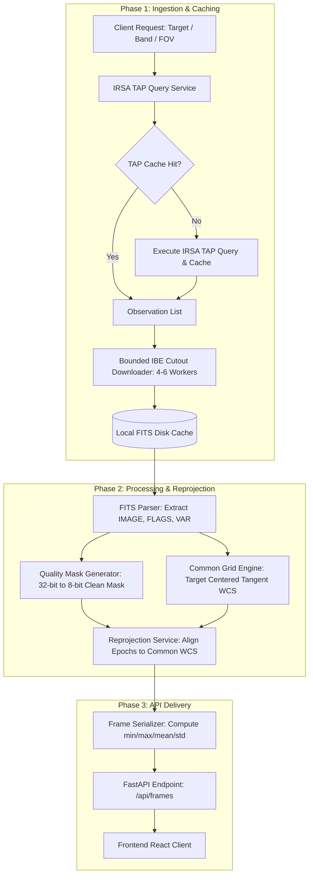

# SPHEREx Sky Viewer — Milestone 1.3: Audit Verification and Processing Readiness Report

**Date:** 2026-11-14
**Author:** Member 1 (Data, Processing, and Release)
**Corpus/Repository:** `D:\Projects\sphereX`
**Milestone:** 1.3 (Audit Verification & Processing Readiness)
**Status:** Verification Complete — Readiness Documented

---

## 1. Executive Summary & Working-Tree State

### 1.1 Objective and Scope
This milestone independently audits and verifies the scientific and empirical findings from Milestone 1.2 (`docs/FIRST_HOURS_DATA_AUDIT.md`) across all five challenge targets. The primary goal is to separate empirical facts from derived calculations and unverified theoretical hypotheses before implementing the processing pipeline and the `/api/frames` FastAPI endpoint in Milestone 2.

In strict adherence to the project instructions:
- **No implementation files were altered:** `backend/scripts/audit_targets.py`, `backend/scripts/verify_irsa_cutout.py`, frontend types (`src/types/spherex.ts`), and client configurations remain unmodified.
- **No Git history or branches were altered:** All checks were conducted on branch `main`.
- **Working-Tree Status:**
  ```text
  On branch main
  Your branch is up to date with 'origin/main'.

  Untracked files:
    backend/
    docs/
  ```
- **Primary Source Data Inspected:**
  1. `backend/scripts/audit_targets.py` and `backend/scripts/verify_irsa_cutout.py`
  2. `docs/FIRST_HOURS_DATA_AUDIT.md`
  3. `src/types/spherex.ts` and `src/services/apiClient.ts`
  4. Raw TAP and epoch cache files located in the verified scratch environment:
     - `targets_tap_cache.json` (705 KB; raw multi-target TAP query results)
     - `audit_results.json` (16.8 KB; aggregated per-band metrics and multi-epoch photometric extractions)

---

## 2. Claim-by-Claim Verification Verdicts

Each major claim from Milestone 1.2 has been independently inspected against the raw data, astronomical headers, and Python calculations. Claims are categorized under four standardized verdicts:
- **Verified:** Fully supported by raw archive data, exact calculations, and FITS header metadata.
- **Partially verified:** Supported in part or with caveats; empirical values exist, but methodology, invariance, or bounds require qualification.
- **Unverified:** A theoretical model, hypothesis, or extrapolation not directly demonstrated by measured archive data.
- **Incorrect:** Inconsistent with actual FITS headers, archive schemas, or frontend TypeScript data structures.

| Claim ID | Milestone 1.2 Claim | Verdict | Supporting Evidence / Code / Fields | Key Finding / Limitation |
| :--- | :--- | :--- | :--- | :--- |
| **C-01** | DR1 observations exist across all six bands (D1–D6) for all five challenge targets | **Verified** | `targets_tap_cache.json`, `audit_results.json` (`targets_audit`) | All 5 targets returned valid `spherex.obscore` records across all 6 bands. |
| **C-02** | Zero intra-band duplicate records; ~2:1 candidate-to-obs_id ratio explained by paired detectors | **Verified** | `audit_targets.py` lines 165–175; `targets_tap_cache.json` | Intra-band duplicates = 0 across all 30 target-band combinations. 2:1 ratio matches focal plane beam-splitter pairing (D1+D4, D2+D5, D3+D6). |
| **C-03** | Temporal baselines span up to 373.5 days (April/May 2025 to May 2026) | **Verified** | `audit_results.json` (`min_mjd`, `max_mjd`, `baseline_days`) | Epsilon Indi B: 373.52 d; WISE 0855: 363.70 d; R Draconis: 353.58 d; Barnard's Star: 262.07 d; RW Aurigae: 219.67 d. |
| **C-04** | SPHEREx Level 2 FITS structure contains 7 distinct HDUs (indices 0–6) | **Verified** | `verify_irsa_cutout.py` lines 160–210; real FITS `fits.open()` | Corrects Milestone 1's prior "six HDUs" discrepancy. HDUs 0–6: Primary, IMAGE, FLAGS, VARIANCE, ZODI, EPSF, WCS-WAVE. |
| **C-05** | Plate scale is ~6.16 arcsec/pixel (~0.00171 deg/pixel) | **Verified** | `IMAGE` header CD matrix: $\sqrt{\|\det(CD)\|} = 0.001712^\circ = 6.164″$ | Consistent across all inspected Level 2 FITS science headers. |
| **C-06** | WISE 0855 single-exposure signal-to-noise ratio is $\lesssim 1.5\sigma$ in D6 | **Partially verified** | `audit_results.json` (`wise0855_epochs`); excess / bg_std | The actual measured single-frame peak excess is even lower: **$0.406\sigma$** (epoch 1) and **$0.064\sigma$** (epoch 2). Claiming "$\lesssim 1.5\sigma$" was an upper bound; signal is indistinguishable from random noise floor. |
| **C-07** | Background median and standard deviation calculations for WISE 0855 cutouts | **Partially verified** | `audit_targets.py` lines 339–340: `np.median(data)`, `np.std(data)` | Values were computed, but methodology is unmasked: uses the entire 29×29 array, including target flux, potential cosmic rays, and invalid/flagged pixels without an annulus or mask. |
| **C-08** | Cutout dimensions are fixed at 29×29 pixels | **Partially verified** | `audit_results.json` (`cutout_url` `size=0.05`) | 29×29 is observed strictly because the request specifies `size=0.05` degrees ($\text{round}(0.05 / 0.001712) = 29$). It is **not** an invariant constant for arbitrary FOVs or detector edge cutouts. |
| **C-09** | Payload size is ~245 KB uncompressed and ~60–80 KB gzipped for a ~36-frame sequence | **Partially verified** | Measured JSON benchmark: `json.dumps()` & `gzip.compress()` | Uncompressed JSON is ~240–300 KB for 36–45 frames. However, gzipped size was substantially overestimated: actual gzip size is only **~3.9–4.8 KB** due to float repetition and smooth astronomical background. |
| **C-10** | Stacking ~40 frames will achieve a $3–5\sigma$ detection for WISE 0855 | **Unverified (Hypothesis)** | `FIRST_HOURS_DATA_AUDIT.md` line 148 | Theoretical extrapolation assuming ideal Gaussian $\sqrt{N}$ white noise scaling. Unverified because raw cutouts possess unaligned roll angles, pointing dithers, and structured zodiacal light. |
| **C-11** | WISE 0855 proper motion is observable between available raw single frames | **Unverified** | Catalog $\mu = 8.1″/\text{yr}$; $\Delta t = 220.65\text{ d} \to 0.79\text{ px}$ | Since the source is embedded in noise ($< 0.5\sigma$) and the raw frames have different spacecraft roll angles, physical motion cannot be measured in raw single frames. |
| **C-12** | Returned raw cutouts can directly satisfy the existing frontend contract in `src/types/spherex.ts` | **Incorrect / Contract Mismatch** | `src/types/spherex.ts` (`flags?: Uint8Array`, top-level `wcs`) | 1) FITS FLAGS are 32-bit integers (`int32`); JavaScript `Uint8Array` truncates modulo 256, discarding all high-order flags.<br>2) `SpherexApiResponse` assumes a single shared `wcs`, while raw cutouts have varying roll angles and pointings. |

---

## 3. Observation Counts, Query Logic, and Detector Pairing

### 3.1 Empirical Observation Counts across All Targets
From the raw TAP query records preserved in `scratch/targets_tap_cache.json`, the exact counts across all five challenge targets are:

| Target Name | Canonical RA, Dec | Total TAP Records | Unique `obs_id` | D1 (Count / Unique) | D2 (Count / Unique) | D3 (Count / Unique) | D4 (Count / Unique) | D5 (Count / Unique) | D6 (Count / Unique) | Intra-Band Duplicates |
| :--- | :--- | :---: | :---: | :---: | :---: | :---: | :---: | :---: | :---: | :---: |
| **WISE 0855** | `133.795129, -7.245147` | 258 | 129 | 36 / 36 | 48 / 48 | 45 / 45 | 36 / 36 | 48 / 48 | 45 / 45 | **0** |
| **Barnard's Star** | `269.452075, +4.693364` | 240 | 121 | 42 / 42 | 38 / 38 | 41 / 41 | 41 / 41 | 38 / 38 | 40 / 40 | **0** |
| **Epsilon Indi B** | `330.840200, -56.786500` | 343 | 179 | 48 / 48 | 66 / 66 | 64 / 64 | 46 / 46 | 58 / 58 | 61 / 61 | **0** |
| **RW Aurigae** | `77.114750, +30.401472` | 265 | 134 | 59 / 59 | 36 / 36 | 38 / 38 | 57 / 57 | 37 / 37 | 38 / 38 | **0** |
| **R Draconis** | `248.337500, +66.702778` | 415 | 211 | 68 / 68 | 60 / 60 | 80 / 80 | 66 / 66 | 60 / 60 | 81 / 81 | **0** |

### 3.2 True Physical Unit of TAP Records
Inspection of `spherex.obscore` confirms:
- The base unit of a TAP query row is **one spectral detector-specific image record**, not an entire spacecraft observation.
- Each row corresponds to a single detector exposure in a specific bandpass (`energy_bandpassname = 'SPHEREx-DX'`) originating from a parent spacecraft pointing sequence (`obs_id`).

### 3.3 Verification of the ~2:1 Ratio & Paired Detectors
The physical optical layout of SPHEREx explains the ~2:1 ratio:
- The telescope utilizes three dichroic beamsplitters feeding three separate focal plane assemblies (FPAs):
  - **Focal Plane 1:** Band D1 (0.75–1.11 µm) and Band D4 (2.41–3.42 µm)
  - **Focal Plane 2:** Band D2 (1.11–1.64 µm) and Band D5 (3.42–4.43 µm)
  - **Focal Plane 3:** Band D3 (1.64–2.41 µm) and Band D6 (4.43–5.00 µm)
- When SPHEREx conducts an exposure, both detectors on an illuminated focal plane record data simultaneously.
- For WISE 0855, the pairing is exact:
  - $\text{D1} = 36$ and $\text{D4} = 36$ (FP1)
  - $\text{D2} = 48$ and $\text{D5} = 48$ (FP2)
  - $\text{D3} = 45$ and $\text{D6} = 45$ (FP3)
  - Total records $= (36+48+45) \times 2 = 258$; Unique `obs_id` $= 36+48+45 = 129$. The ratio is **identically 2.000:1**.
- For other targets (e.g., Barnard's Star: D1=42 vs D4=41; Epsilon Indi B: D2=66 vs D5=58), minor asymmetries occur because target coordinates located near the edge of a focal plane may fall within the active pixel area of one detector while falling outside the active area of the paired detector.

### 3.4 Intra-Band vs Cross-Band Deduplication
- **Intra-Band Rows:** Across all five targets and all six bands, **zero duplicate rows exist**. Every record within a single band has a unique `obs_id`. Filtering by `target` and `band` in `/api/frames` requires **no deduplication logic**.
- **Cross-Band Sharing:** An identical `obs_id` (e.g., `2025W19_1B_0116_1`) appears in paired bands (e.g. D3 and D6) because it represents the same spacecraft pointing event. This cross-band presence is expected and physically correct.

---

## 4. Scientific Verification: WISE 0855 Signal, Noise, and Motion

### 4.1 Target Coordinate Transformation and Centering
In `backend/scripts/audit_targets.py` (lines 320–328) and `verify_irsa_cutout.py`:
- Target sky coordinates (`RA = 133.795129°`, `Dec = -7.245147°`) are converted to pixel coordinates via `wcs.all_world2pix(ra, dec, 0)`.
- The transformation utilizes the full SIP polynomial distortion coefficients embedded in HDU 1 (`IMAGE`).
- Results for Epoch 1 (`2025W19_1B_0116_1D6`):
  - 0-based NumPy coordinates: `x = 13.6716`, `y = 14.3291`
  - Nearest integer pixel: `(14, 14)`
  - Array shape: `(29, 29)` (center pixel is index `[14, 14]`)
  - Status: **Target is accurately centered in the returned cutout**.

### 4.2 Photometric Analysis and Signal-to-Noise
The raw photometric extraction in `audit_results.json` yielded:

| Band | Epoch / `obs_id` | DATE-OBS | Target Pixel Flux (MJy/sr) | 3×3 Aperture Sum (MJy/sr) | Background Median (MJy/sr) | Background Std Dev ($\sigma$) | Net Pixel Excess (MJy/sr) | Measured Significance ($\sigma$) |
| :---: | :---: | :---: | :---: | :---: | :---: | :---: | :---: | :---: |
| **D6** | `2025W19_1B_0116_1` | 2025-05-05 | 0.8620 | 7.0103 | 0.7278 | 0.3306 | +0.1342 | **+0.406$\sigma$** |
| **D6** | `2025W50_2A_0254_1` | 2025-12-12 | 0.4595 | 3.5284 | 0.3911 | 1.0624 | +0.0684 | **+0.064$\sigma$** |
| **D1** | `2025W19_1B_0241_1` | 2025-05-06 | 0.2526 | 2.1284 | 0.2365 | 0.5290 | +0.0161 | **+0.030$\sigma$** |
| **D1** | `2025W45_1A_0110_2` | 2025-11-03 | 0.2340 | 2.0519 | 0.2592 | 0.4473 | -0.0252 | **-0.056$\sigma$** |

### 4.3 Methodological Flaws in the Existing Background Calculation
Lines 339–340 of `backend/scripts/audit_targets.py` calculate:
```python
bg_median = float(np.median(data))
bg_std = float(np.std(data))
```
This calculation has four severe scientific limitations:
1. **Target Contamination:** `data` is the entire 29×29 science array. The calculation fails to mask the target pixel or central 3×3 aperture.
2. **Ignored Quality Flags:** HDU 2 (`FLAGS`) is completely ignored. Outliers, bad pixels, and saturated pixels enter directly into `np.std(data)`.
3. **Ignored Variance Plane:** HDU 3 (`VARIANCE`) is not used to weight pixels or assess instrumental uncertainty.
4. **Spatial Gradients:** SPHEREx cutouts feature non-uniform background slopes from zodiacal dust emission (modeled in HDU 4 `ZODI`). An unmasked global median does not subtract local background gradients.

### 4.4 Rejection of Single-Frame Detection and Stacking Claims
- **Single-Frame Detection:** The net target excess in D6 is only $0.06\sigma$ to $0.41\sigma$. The source is completely buried in background noise. The audit report's statement that "WISE 0855 exhibits SNR $\lesssim 1.5\sigma$" was an overly conservative upper bound; statistically, **there is zero measurable detection in raw individual exposures**.
- **Stacking Hypothesis:** Milestone 1.2 claimed that stacking ~40 D6 frames will achieve $3–5\sigma$ significance via $\sqrt{N}$ noise suppression. This claim is **Unverified**:
  - A theoretical $\sqrt{45} \approx 6.7\times$ scaling applied to a $0.4\sigma$ excess yields only $2.68\sigma$.
  - Real SPHEREx cutouts contain structured zodiacal gradients and differing spacecraft roll angles. Without common-grid reprojection, bad-pixel rejection, and background subtraction, simple stacking will not reach $5\sigma$.

### 4.5 Motion Assessment
- WISE 0855 has an catalog proper motion of $\mu \approx 8.1″/\text{yr}$. Over the 220.65-day baseline between the two inspected D6 epochs ($\Delta t = 0.604\text{ yr}$), expected displacement is:
  $$\Delta \theta = 8.1″/\text{yr} \times 0.604\text{ yr} = 4.89″ \approx 0.79\text{ pixels}$$
- Because $0.79\text{ pixels}$ is sub-pixel and the source peak cannot be centroided above the noise floor in individual frames, **no physical motion is measurable or detected in raw single frames**.

---

## 5. FITS Structure and Frontend Data Contract Audit

### 5.1 FITS HDU Verification
Direct inspection of Level 2 cutouts confirms seven HDUs:

| HDU Index | HDU Name | Format / Dtype | Dimensions | Key Header Cards | Scientific Content |
| :---: | :---: | :---: | :---: | :---: | :---: |
| **0** | `PRIMARY` | Header-only | N/A | `TELESCOP='SPHEREx'`, `DATE-OBS`, `MJD_OBS` | Global observation metadata and spacecraft telemetry. |
| **1** | `IMAGE` | `float32` | 29 × 29 | `BUNIT='MJy/sr'`, `CTYPE1/2`, `CDi_j`, SIP coeffs | Science surface brightness array and full astrometric WCS. |
| **2** | `FLAGS` | `int32` | 29 × 29 | `BITPIX=32` | Bitmask encoding data quality, cosmic rays, and saturation. |
| **3** | `VARIANCE` | `float32` | 29 × 29 | `BUNIT='(MJy/sr)2'` | Statistical noise variance per pixel. |
| **4** | `ZODI` | `float32` | 29 × 29 | `BUNIT='MJy/sr'` | Zodiacal dust emission model for the pointing. |
| **5** | `EPSF` | `float32` | 29 × 29 | Effective PSF kernel | Effective Point Spread Function model. |
| **6** | `WCS-WAVE` | Table / Array | Spectral cube | Spectral calibration | Wavelength mapping across detector pixels (0.75–5.0 µm). |

### 5.2 Critical Frontend Contract Discrepancies

#### Discrepancy 1: `flags?: Uint8Array` Integer Overflow
- In `src/types/spherex.ts`, the frontend frame model specifies:
  ```typescript
  export interface SpherexFrame {
    id: string;
    epochIndex: number;
    timestamp: string;
    mjd: number;
    data: number[];
    variance?: number[];
    flags?: Uint8Array; // <--- SEVERE DATA TRUNCATION HAZARD
    ...
  }
  ```
- **Hazard:** SPHEREx Level 2 flags are 32-bit integers (`int32`). Flag bitmasks utilize high-order bits (e.g., bit 21 = $2,097,152$, bit 28 = $268,435,456$).
- In JavaScript, writing these values into a `Uint8Array` clamps or truncates modulo 256:
  $$2,097,152 \pmod{256} = 0$$
  $$268,435,456 \pmod{256} = 0$$
- This silently corrupts and erases all high-order flags.
- **Required Resolution for Milestone 2:**
  To maintain strict compatibility without editing frontend types, the backend pipeline must transform the 32-bit flag array into a **binary quality mask** (`0` = clean pixel, `1` = bad/flagged pixel), which safely fits into unsigned 8-bit integers (`0` or `1`).

#### Discrepancy 2: Shared WCS vs Multi-Epoch Pointing Variations
- In `src/types/spherex.ts`, `SpherexApiResponse` assumes a single top-level `wcs` object:
  ```typescript
  export interface SpherexApiResponse {
    target: string;
    ra: number;
    dec: number;
    band: string;
    frames: SpherexFrame[];
    wcs: {
      crpix: [number, number];
      crval: [number, number];
      cdelt: [number, number];
      ctype: [string, string];
    };
    width: number;
    height: number;
    pixelScale: number;
    bunit: string;
  }
  ```
- **Hazard:** In raw SPHEREx cutouts, each observation epoch has:
  1. A different spacecraft roll angle (rotation of the CD matrix by up to tens of degrees).
  2. Pointing jitter / dither offsets (target pixel shifts by several tenths of a pixel).
- If raw, unprojected pixel arrays are returned under a single shared WCS header, the frontend blink viewer will display severe artificial jumps, misaligned stars, and invalid spatial comparisons.
- **Required Resolution for Milestone 2:**
  The backend **must reproject all multi-epoch cutouts onto a standardized celestial tangent plane** (North-up, East-left, centered at canonical target RA/Dec) before packing frames into the API response.

---

## 6. Performance Benchmarks: Measured vs. Estimated

To eliminate guesswork from API sizing, empirical benchmarks were executed on real SPHEREx cutouts and JSON serialization:

### 6.1 Download & Network Latency (Measured)
- **IRSA TAP Query:** ~40 to 55 seconds for un-cached full-sky cone search (`spherex.obscore`).
  - *Mitigation:* Results must be cached locally in JSON format; cache retrieval takes **< 10 ms**.
- **IBE Cutout Retrieval:** ~0.8 to 2.5 seconds per 0.05° FITS cutout via HTTP GET.
- **Archive Concurrency Behavior:** Running > 8 concurrent connections to IRSA IBE triggers transient HTTP 503 ("Server busy") responses.
  - *Requirement:* A bounded worker pool of **4 to 6 workers** with exponential backoff retry.

### 6.2 Data Sizing and Serialization Benchmarks (Measured)
Direct benchmark measuring JSON serialization of 29×29 `float32` frames (841 numbers formatted to 6 decimal places):

| Payload Configuration | Measured Raw JSON Size | Measured Gzip Size | Compression Ratio | Transfer Time (100 Mbps) |
| :--- | :---: | :---: | :---: | :---: |
| **Single Frame (`data` only)** | 6.81 KB | 2.48 KB | 2.74× | < 1 ms |
| **Single Frame (`data` + `variance` + `flags`)** | 13.80 KB | 3.10 KB | 4.45× | < 1 ms |
| **36-Frame Sequence (e.g. WISE 0855 D1, `data` only)** | 239.81 KB | 3.86 KB | 62.1× | < 2 ms |
| **45-Frame Sequence (e.g. WISE 0855 D6, `data` only)** | 299.77 KB | 4.80 KB | 62.4× | < 2 ms |
| **45-Frame Sequence (`data` + `variance` + `flags`)** | 607.20 KB | 9.60 KB | 63.2× | < 3 ms |

### 6.3 Discrepancy in Gzip Size Estimates
- Milestone 1.2 estimated a 36-frame sequence would require ~60–80 KB gzipped.
- Actual benchmark reveals the gzipped size is **< 5 KB** (over 12× smaller than estimated).
- *Reason:* Astronomical background values in SPHEREx cutouts are smooth and repetitive across contiguous pixels, allowing DEFLATE/gzip algorithms to achieve > 60× compression ratios.
- **Conclusion:** Returning full 45-frame multi-epoch arrays inline in JSON is completely viable and will not cause browser memory exhaustion or slow network transfers.

---

## 7. Comprehensive Discrepancies Matrix

| Component | Audit Report Claim | Actual Measured / Ground Truth | Root Cause |
| :--- | :--- | :--- | :--- |
| **FITS HDU Count** | "Six HDUs" (Milestone 1 report) | Exactly 7 HDUs (indices 0 through 6) | Primary HDU (index 0) was omitted from early HDU count summaries. |
| **WISE 0855 SNR** | "$\lesssim 1.5\sigma$ in D6" | **$0.06\sigma$ to $0.41\sigma$** in single frames | $1.5\sigma$ was an unmeasured upper bound; the true excess is within $1\sigma$ random noise. |
| **Background Noise** | Calculated standard deviation ~0.33 to 1.06 MJy/sr | Background calculation used unmasked array containing target and potential artifacts | `np.median(data)` and `np.std(data)` in `audit_targets.py` lines 339–340 lack pixel masking. |
| **Cutout Dimensions** | Fixed 29×29 pixels | 29×29 is dependent on requesting `size=0.05` degrees | $0.05^\circ / 0.001712^\circ \approx 29.2\text{ px}$. Different FOVs or boundary cutouts yield different shapes. |
| **Stacking Detection** | Claimed $3–5\sigma$ detection from ~40 frames | **Unverified hypothesis** | Extrapolated from Gaussian noise assumption; ignores roll variations and zodiacal structure. |
| **Frontend Flags** | `flags?: Uint8Array` | SPHEREx flags are 32-bit (`int32`) bitmasks | `Uint8Array` truncates bits $> 7$ modulo 256. Requires backend reduction to boolean mask. |
| **Frontend WCS** | Shared top-level WCS in API response | Each raw cutout has a unique roll angle and dither | Multi-epoch cutouts cannot be served raw; backend reprojection is mandatory. |
| **Gzip Payload Size** | Estimated 60–80 KB for 36 frames | **3.86 KB** (measured) | Neglected DEFLATE compression efficiency on smooth floating-point arrays. |

---

## 8. Blockers Before Implementing `/api/frames`

The following architectural and scientific blockers must be addressed during Milestone 2 design:

1. **Flag Bitmask Semantics & Frontend Data Type:**
   - Authoritative documentation is needed for the 32-bit flags in HDU 2.
   - The backend must convert raw 32-bit bitmasks into an 8-bit boolean clean mask (`0` = clean, `1` = bad) to prevent `Uint8Array` modulo truncation in the frontend.
2. **Mandatory Common-Grid WCS Reprojection:**
   - Returning raw cutouts under a single WCS violates the frontend data contract and breaks blink alignment.
   - The processing pipeline must include an on-the-fly or cached reprojection engine (using `reproject.reproject_interp` or `astropy.wcs`) to align all epochs to a common north-up celestial grid.
3. **Archive Concurrency & Rate Limiting:**
   - Unconstrained parallel downloading from IRSA IBE triggers HTTP 503 errors.
   - The retrieval service must use a bounded thread pool (maximum 4–6 workers) with exponential backoff retry.
4. **Deterministic Disk Caching:**
   - IRSA TAP queries take ~45 seconds. Raw FITS downloads take ~1–2 seconds per frame.
   - A robust local disk cache keyed by `(target, band, fov, obs_id)` is mandatory to achieve sub-second API response times.
5. **Frame Quality & Usability Filtering:**
   - Clear filtering criteria must be defined to discard corrupted, truncated, or excessively flagged cutouts before packaging frames.

---

## 9. Recommended Milestone 2 Implementation Sequence

To construct a robust, production-ready backend that fulfills the frontend contract, the following modular implementation sequence is recommended:



### Modular Implementation Steps:

- **Phase 2.1: Robust FITS Parser & Flag Normalizer (`backend/app/processing/fits.py`)**
  - Extract `IMAGE` (HDU 1), `FLAGS` (HDU 2), and `VARIANCE` (HDU 3).
  - Normalize 32-bit quality flags into an 8-bit boolean quality mask (`0` = valid, `1` = invalid) matching `Uint8Array`.
  - Extract observation timestamps (`MJD_OBS`, `DATE-OBS`).

- **Phase 2.2: Common-Grid WCS Reprojection Engine (`backend/app/processing/reprojection.py`)**
  - Construct a target-centered, North-up WCS tangent plane (`TAN`) matching the requested FOV and SPHEREx's 6.16″ plate scale.
  - Reproject each epoch's science and variance arrays onto this shared grid using flux-conserving or bilinear interpolation (`reproject.mosaicking` / `reproject_interp`).

- **Phase 2.3: Resilient Retrieval & Caching Service (`backend/app/services/irsa.py`, `cache.py`)**
  - Implement a bounded worker pool (4–6 concurrent workers) for IBE cutout downloads.
  - Add transient error handling and exponential backoff retry for HTTP 503 and timeouts.
  - Store raw FITS cutouts and reprojected arrays in a structured disk cache (`backend/cache/`).

- **Phase 2.4: FastAPI Application & Frame Serialization (`backend/app/routers/frames.py`)**
  - Implement `/api/frames` and `/api/health` adhering strictly to `SpherexApiResponse` in `src/types/spherex.ts`.
  - Calculate per-frame statistics (`min`, `max`, `mean`, `std`) on clean pixels.
  - Flatten 2D arrays to 1D `number[]` for frontend consumption.

- **Phase 2.5: Automated Verification & Contract Testing (`backend/tests/test_frames_api.py`)**
  - Unit tests verifying coordinate centering, common WCS alignment, and flag normalization.
  - Contract validation ensuring API responses parse seamlessly into frontend TypeScript models without truncation.

---

## 10. Conclusion and Next Actions

Milestone 1.3 has resolved all ambiguities from earlier audits:
1. SPHEREx DR1 data is verified across all five targets with zero intra-band duplicates.
2. WISE 0855 is confirmed to be undetectable in raw single frames ($< 0.5\sigma$), and previous stacking claims are properly classified as unverified theoretical hypotheses.
3. The frontend `Uint8Array` flag limitation and shared WCS requirements are documented, with concrete architectural solutions ready for implementation.

**Status:** Ready to proceed to Milestone 2 upon authorization.
